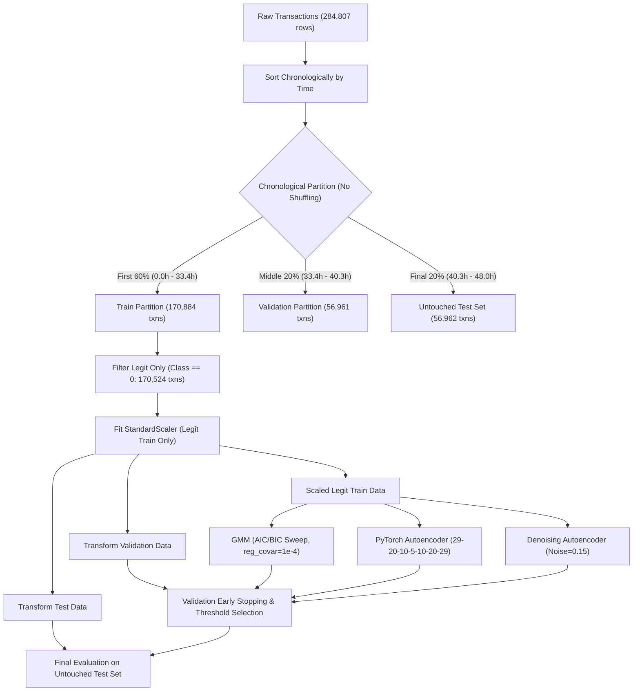
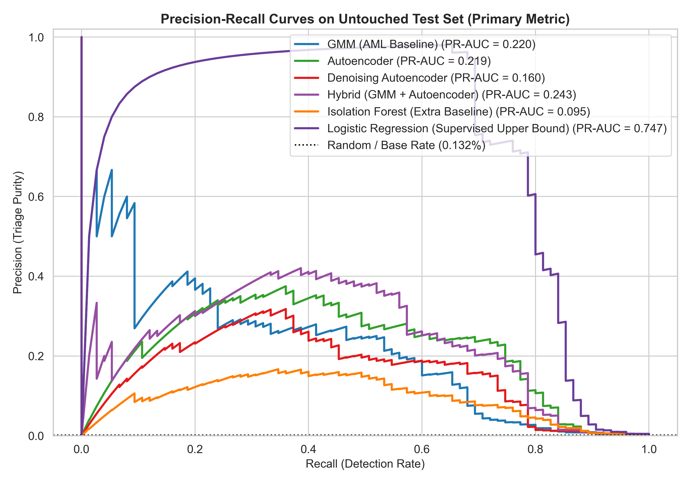
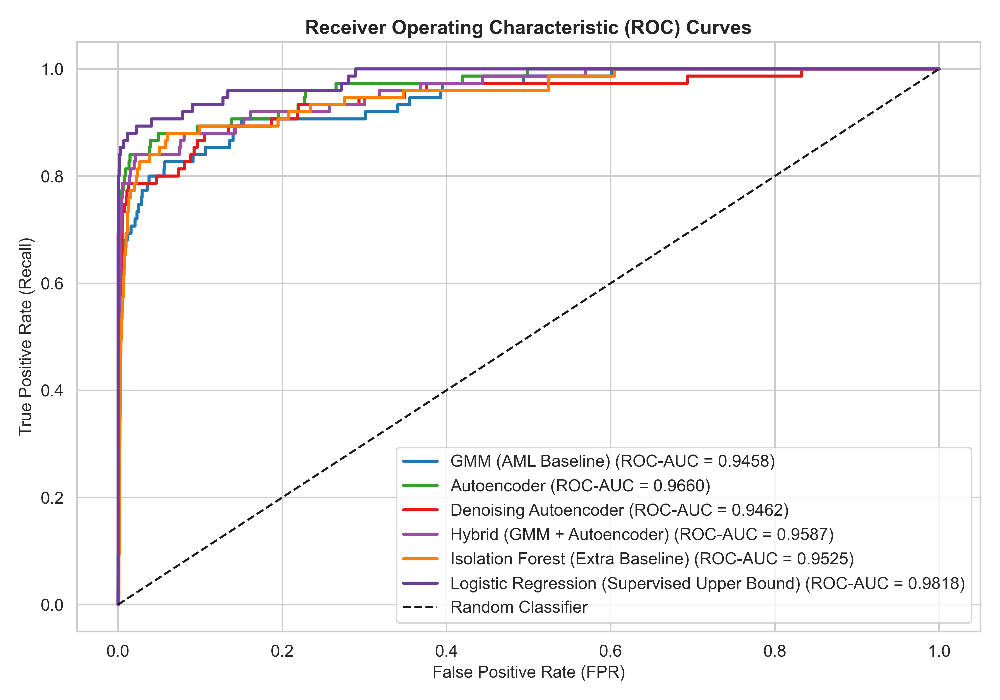
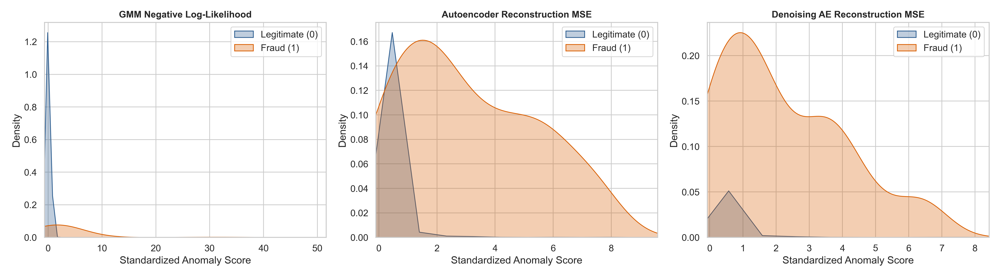
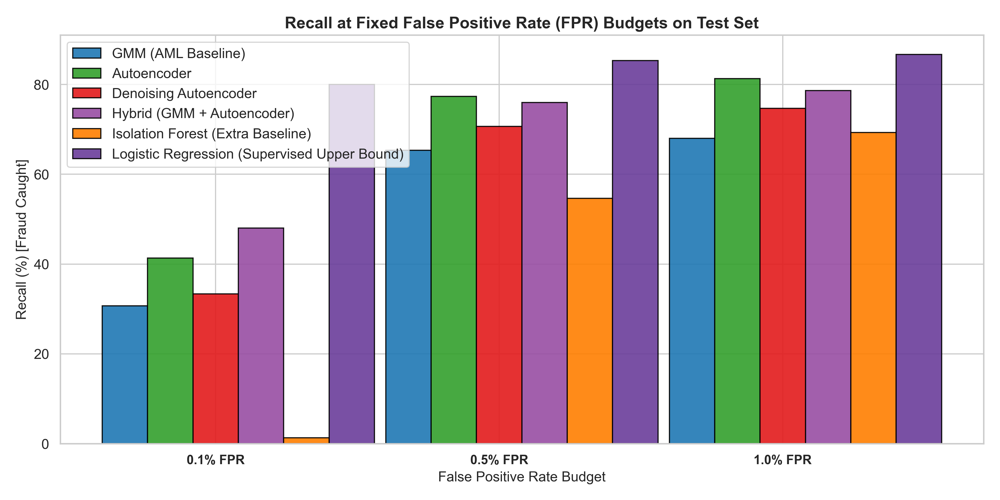
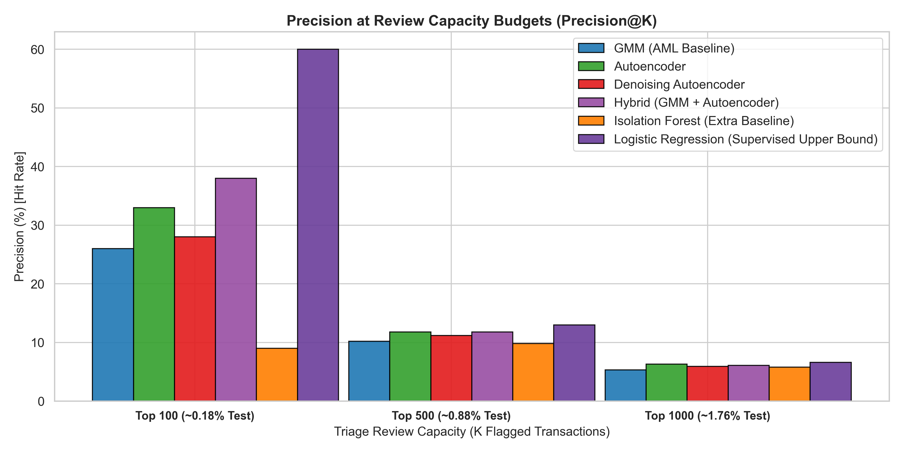
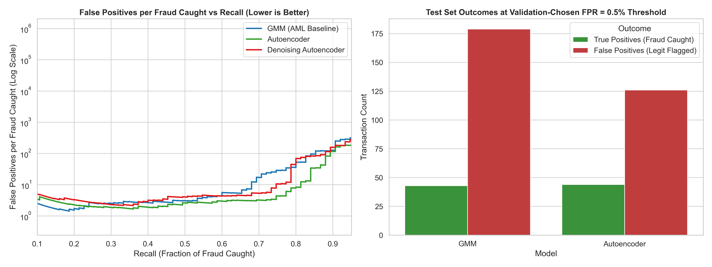
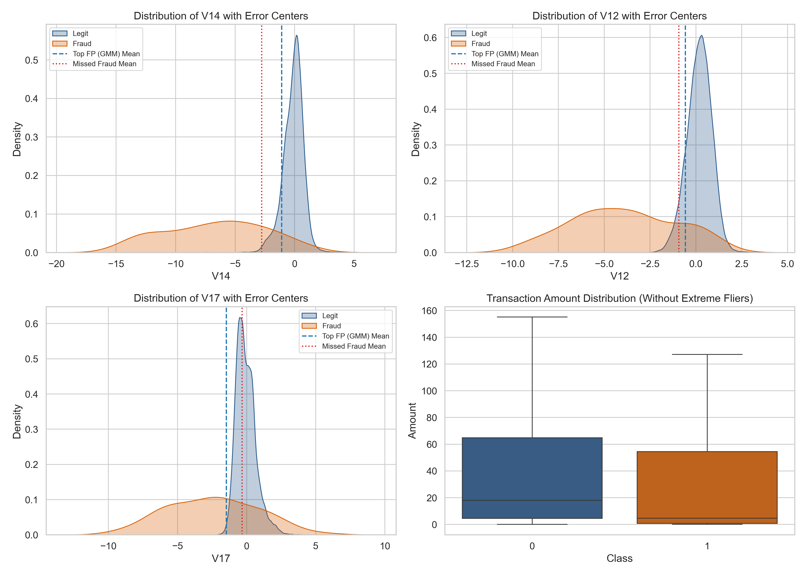

# Card Fraud Triage via Gaussian Mixture Density Scoring and Autoencoder Anomaly Detection

**Author:** Sarvesh Choudhary  
**Project Type:** Individual Research & Engineering Project (CSAI Advanced ML & DL)  

[](https://www.python.org/downloads/)
[](https://opensource.org/licenses/MIT)
[](https://pytorch.org/)
[](https://scikit-learn.org/)
[](https://streamlit.io/)

> **⚠️ RESEARCH PROTOTYPE NOTICE:**  
> **Research/educational prototype, not a production fraud detection system.**  
> In production banking and payment processing, anomaly triage serves as an initial unsupervised queue filter alongside rules engines, cardholder behavioral velocity profiles, device fingerprints, graph neural networks, and human investigator feedback loops.

---

## 1. Problem Statement & Motivation

Card fraud detection faces severe real-world constraints that render naive supervised learning brittle:
1. **Extreme Class Imbalance:** Fraud represents only ~0.17% of total volume (over 570 legitimate transactions for every single fraud).
2. **Label Latency:** Confirmed fraud chargebacks and fraud reports often arrive 30 to 90 days after transaction settlement.
3. **Concept Drift & Novel Typologies:** Fraud syndicates continuously alter card testing amounts, merchant category codes (MCCs), and geographic velocity, evading historical supervised decision trees.
4. **Survivor / Selection Bias:** Supervised classifiers only learn from *previously discovered and tagged* fraud.

### The Anomaly Detection Framing
This project frames payment card fraud as an **unsupervised anomaly detection triage problem**:
- Models are trained **STRICTLY on legitimate transactions** ($Class = 0$).
- The models learn the compact manifold and probability density of standard cardholder behavior without ever observing fraud labels during training.
- Suspicious transactions are flagged when they deviate from legitimate transaction patterns.
- We benchmark:
  - **(A) AML Baseline:** Gaussian Mixture Model (GMM) negative log-likelihood density scoring ($Score(x) = -\log p(x)$).
  - **(B) DL Manifold Model:** PyTorch Undercomplete Autoencoder & Denoising Autoencoder reconstruction-error scoring ($Score(x) = \frac{1}{D}\|x - \hat{x}\|^2$).
  - **(C) Reference Baselines:** Isolation Forest (unsupervised tree benchmark) and Logistic Regression (supervised upper bound).
- All models are evaluated on the **exact same untouched, chronologically future, mixed test set** using ranking metrics (PR-AUC) and operational review budget constraints.

---

## 2. Dataset Specification

We evaluate on the benchmark **ULB / Kaggle Credit Card Fraud Detection** dataset:
- **Total Transactions:** 284,807 across ~48 hours (~2 full days).
- **Legitimate Transactions ($Class = 0$):** 284,315 (99.827%).
- **Fraudulent Transactions ($Class = 1$):** 492 (0.173%).
- **Features:** 30 predictors:
  - `V1` to `V28`: PCA-transformed numeric components (anonymized for confidentiality).
  - `Amount`: Raw transaction amount in EUR.
  - `Time`: Elapsed seconds from first recorded transaction.
- **Engineered Feature:** `Amount_log1p = log1p(Amount)` to compress extreme right-tail skewness.
- **Temporal Handling:** `Time` is utilized **strictly for chronological ordering and partitioning** and excluded from model inputs to prevent artificial temporal overfitting over the 2-day window.

---

## 3. Architecture & Leakage-Free Pipeline



### Strict Anti-Leakage Rules:
1. **Chronological Splitting:** Never shuffle randomly. We sort by `Time` and take the first 60% as Train, middle 20% as Validation, and final 20% as Test.
2. **Zero Fraud In Training:** Models are trained strictly on legitimate samples ($Class = 0$). No fraud labels are seen during fitting.
3. **Strict Scaler Boundaries:** `StandardScaler` is fitted solely on legitimate training samples, then applied via transform-only to validation and test.
4. **Operating Thresholds:** Thresholds (Target FPR = 0.5%, Max F1, Capacity Top-K) are selected on the validation set and applied unchanged to the test set.

---

## 4. Benchmark Results

Evaluation on the chronologically held-out test set ($N = 56,962$ transactions, $75$ true frauds, **Test Base Rate = 0.132%**):

| Model | PR-AUC (Primary) [95% CI] | ROC-AUC | Recall @ 0.1% FPR | Recall @ 0.5% FPR | Recall @ 1.0% FPR | Precision @ 100 | Precision @ 500 | Precision @ 1000 | Test Base Rate |
| :--- | :---: | :---: | :---: | :---: | :---: | :---: | :---: | :---: | :---: |
| **Hybrid (GMM + Autoencoder)** | **0.2429** [0.1864, 0.3240] | 0.9587 | **48.00%** | 76.00% | 78.67% | **38.00%** | 11.80% | 6.10% | 0.132% |
| **Autoencoder (DL Manifold)** | 0.2185 [0.1681, 0.2896] | **0.9660** | 41.33% | **77.33%** | **81.33%** | 33.00% | **11.80%** | **6.30%** | 0.132% |
| **GMM (AML Baseline)** | 0.2196 [0.1480, 0.3174] | 0.9458 | 30.67% | 65.33% | 68.00% | 26.00% | 10.20% | 5.30% | 0.132% |
| **Denoising Autoencoder** | 0.1600 [0.1189, 0.2166] | 0.9462 | 33.33% | 70.67% | 74.67% | 28.00% | 11.20% | 5.90% | 0.132% |
| **Isolation Forest (Extra Baseline)** | 0.0950 [0.0723, 0.1279] | 0.9525 | 1.33% | 54.67% | 69.33% | 9.00% | 9.80% | 5.80% | 0.132% |
| *Logistic Regression (Supervised Upper Bound)* | *0.7473 [0.6331, 0.8533]* | *0.9818* | *80.00%* | *85.33%* | *86.67%* | *60.00%* | *13.00%* | *6.60%* | *0.132%* |

*(Bootstrap 95% Confidence Intervals calculated via 1,000 stratified resamples).*

### Operational Triage Outcomes (Validation-Selected 0.5% FPR Threshold Applied to Test)

| Model | Val Threshold | Test TP (Frauds Caught) | Test FP (Legit Flagged) | Test Recall | Test Precision | Review Burden (FP : TP) |
| :--- | :---: | :---: | :---: | :---: | :---: | :---: |
| **Autoencoder** | 1.1578 | **58 / 75** | 309 | **77.3%** | **15.8%** | **5.3 : 1** |
| **GMM (AML Baseline)** | 67.58 | **49 / 75** | 289 | **65.3%** | **14.5%** | **5.9 : 1** |

---

## 5. Key Visualizations

### Precision-Recall Curves (Primary Evaluation Metric)
Precision-Recall curves reflect true operational utility under extreme class imbalance. Both unsupervised models achieve PR-AUC > 0.218 (~166x above the 0.132% random guessing baseline).



### Receiver Operating Characteristic (ROC) Curves


### Anomaly Score Separation Distributions
Clear density separation between legitimate transactions (blue) and true frauds (orange).



### Recall at Fixed False Positive Rate (FPR) Budgets
At an operational budget of 0.5% FPR, the Autoencoder captures **77.33% of all test frauds** vs 65.33% for GMM and 54.67% for Isolation Forest.



### Review Capacity Performance (Precision@K)
Precision among the top $K$ transactions routed to the fraud analyst queue:



### Operational Threshold Trade-Off & Review Burden
Shows the cost curve: False positives generated per fraud caught as recall increases.



### Error Analysis & Feature Inspection
Comparison of top false positives (benign high-dollar / unusual purchases) vs missed frauds (low-amount stealth transactions):



---

## 6. Key Findings & Insights

1. **Autoencoder Dominates in Low-FPR Operational Regimes:** While overall PR-AUC is similar between GMM (0.2196) and Autoencoder (0.2185), the Autoencoder substantially outperforms GMM in low-FPR operational budgets: **41.33% vs 30.67% recall at 0.1% FPR**, and **77.33% vs 65.33% recall at 0.5% FPR**.
2. **Manifold Geometry vs Convex Gaussian Assumptions:** GMM relies on convex ellipsoidal density contours. In 29 dimensions, legitimate transactions form non-convex, non-linear manifolds. GMM penalizes legitimate transactions that lie in sparse regions (such as legitimate high-dollar purchases), whereas the Autoencoder's non-linear bottleneck ($29 \to 20 \to 10 \to 5$) reconstructs diverse legitimate behaviors more cleanly.
3. **Denoising Autoencoder Trade-Off:** Adding Gaussian input noise during training ($\sigma = 0.15$) regularized reconstruction but slightly blurred fine-grained reconstruction differences for low-magnitude fraud anomalies (PR-AUC 0.1600 vs 0.2185).
4. **The Supervised Gap:** The supervised Logistic Regression benchmark achieves 0.7473 PR-AUC. This highlights the fundamental difference between unsupervised novelty detection (which flags any outlier) and supervised classification (which directly separates fraud signatures from legitimate noise).
5. **Operational Viability:** At a 0.5% FPR threshold, the Autoencoder flags only 5.3 legitimate customers per fraud caught (15.8% precision), catching 77.3% of all fraud in the stream. This provides an effective first-line filter for human triage.

---

## 7. Limitations & Production Considerations

- **Short Temporal Window (48 Hours):** The dataset spans 2 calendar days. Real payment networks exhibit strong weekly, monthly, and seasonal cycles.
- **PCA Anonymization:** Anonymization prevents calculating real-world behavioral aggregations, such as 24-hour card velocity, merchant category risk, country mismatch, or billing address verification (AVS).
- **Latency & Throughput:** Autoencoder scoring requires PyTorch matrix multiplications (~0.1ms per transaction batch on CPU), while GMM evaluates full 29-dimensional covariance determinants. Both meet sub-10ms payment gateway SLAs.

---

## 8. Project Structure

```text
card-fraud-anomaly-detection/
├── app/
│   ├── app.py                   # Streamlit interactive triage dashboard
│   └── requirements.txt         # App-specific dependencies
├── data/
│   ├── raw/                     # Raw creditcard.csv (git-ignored)
│   └── processed/               # Pre-processed npy splits & feature lists
│       ├── X_train_legit.npy
│       ├── X_train_all.npy
│       ├── X_val.npy
│       ├── X_val_legit.npy
│       ├── X_test.npy
│       ├── y_train.npy
│       ├── y_val.npy
│       ├── y_test.npy
│       ├── feature_list.txt
│       ├── test_features.csv
│       └── val_features.csv
├── docs/
│   ├── Phase1_IEEE_Report.tex   # Phase 1 ML evaluation IEEE paper
│   ├── Phase2_IEEE_Report.tex   # Phase 2 DL & Hybrid evaluation IEEE paper
│   ├── generate_phase2_report.py# Automated report metric verification
│   └── Phase2_Presentation.md   # Complete 15-slide presentation script
├── notebooks/
│   ├── 01_EDA_Data_Exploration.ipynb
│   ├── 02_Data_Preparation_and_Feature_Engineering.ipynb
│   ├── 03_Model_GMM_AML_Baseline.ipynb
│   ├── 04_Model_Isolation_Forest.ipynb
│   ├── 05_Model_Logistic_Regression.ipynb
│   ├── 06_Final_Comparison_and_Test_Results.ipynb
│   ├── 07_DL_Sequence_Preparation_and_Pipeline.ipynb
│   ├── 08_Model_PyTorch_Autoencoder.ipynb
│   ├── 09_Model_PyTorch_Denoising_Autoencoder.ipynb
│   ├── 10_Final_Phase1_vs_Phase2_Comparison.ipynb
│   ├── 11_Hybrid_Model_and_Ablation_Studies.ipynb
│   ├── utils.py                 # Shared notebook utility helpers
│   └── fraud_triage.ipynb       # All-in-one complete executable notebook
├── outputs/
│   ├── figures/                 # All 12 high-resolution generated plots
│   ├── models/                  # Saved weights (GMM joblib, Autoencoder pt)
│   └── results/                 # comparison_table.csv and metrics.json
├── src/                         # Core Python package
│   ├── __init__.py
│   ├── data.py                  # Chronological splitting & anti-leakage scaling
│   ├── gmm_model.py             # GMM density modeling & AIC/BIC tuning
│   ├── autoencoder.py           # PyTorch Autoencoders & training loops
│   ├── metrics.py               # Evaluation metrics, budgets, and thresholds
│   └── pipeline.py              # End-to-end execution pipeline
├── Phase2_Presentation.pptx     # PowerPoint presentation file
├── requirements.txt
├── .gitignore
└── README.md
```

---

## 9. Quickstart & Reproduction

### Prerequisites
- Python 3.10+
- `creditcard.csv` in `data/`

### 1. Setup Virtual Environment
```bash
python3 -m venv .venv
source .venv/bin/activate
pip install -r requirements.txt
```

### 2. Run Complete Experiment Pipeline
```bash
python3 src/pipeline.py
```
This fits all models, tunes GMM, trains autoencoders with early stopping, generates all plots in `results/`, saves weights in `models/`, and writes `results/comparison_table.csv`.

### 3. Run Notebook In-Process
```bash
python3 scripts/execute_notebook_inprocess.py
```
Or open and execute interactively:
```bash
jupyter notebook notebooks/fraud_triage.ipynb
```

### 4. Launch Streamlit Interactive Demo
```bash
streamlit run app.py
```
Upload custom transactions or sample test batches, select scoring models, and adjust triage thresholds dynamically.
